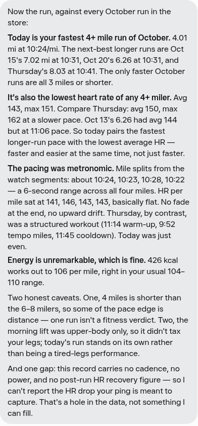
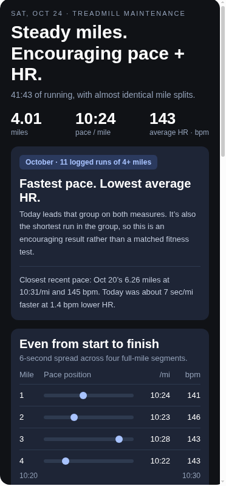
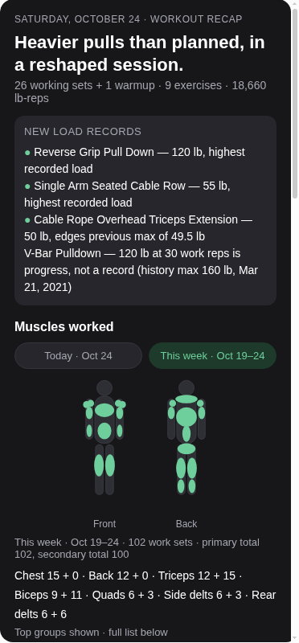
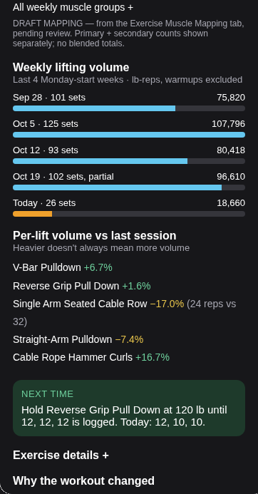

# Workout Data Pipeline

I've been training for marathons this year (Copenhagen May 2026; Philadelphia Nov 2026) and I have a ton of data available from various apps to analyze and help me make progress. Unfortunately, that data is siloed across various apps (Fitbod for weightlifting; Apple Watch/Health for running, heart rate, other vitals; Google Sheets for my training schedule; various LLMs for nutrition tracking).

To get feedback from AI, I was manually sending snapshots of workout data to different LLMs. It was cumbersome and unreliable.

I built this pipeline to bring that data together and keep my training history independent of any one AI model, so I can change models without rebuilding the data layer. The repo holds the portable parts: a Python ingestion layer that imports Fitbod workout CSV exports and Apple Health workout records into SQLite without duplicating or dropping records.

On top of that history sits a coaching layer, which hit v1 in October 2026: an AI coach that logs workouts and meals into a portable record, and answers with structured, visual debriefs I designed. This README covers both halves, plus how I ran the project, because the product decisions are most of the story.

## What the output looks like now

Early on, post-workout answers came back as long paragraphs, and the format kept changing. Finding the one thing I wanted meant re-reading the whole reply. 

I designed the outputs into fixed, glanceable card templates, iterating in the chat until the information I check first was on top. What actually improved: a clearer hierarchy (headline stats and the verdict up top) and more cautious interpretation (comparisons are labeled against my own logged history, not generic benchmarks).

Before: a real post-run debrief from my logs (paragraphs, no structure).



After: the same run (Oct 24, 2026) as a recap card. Headline stats up top, the verdict, mile-split pacing, and comparisons against my own recent history.



The weightlifting report got the same treatment: muscle-group figures with primary and secondary set counts I can expand to see contributing exercises, a Today / This week toggle with the exact date window labeled next to each total, weekly volume, per-lift change versus last session, and a next-time note.





## How the coaching layer works today

There is no app and no server. The coach is an AI assistant (Muse) working from two things I control: the training history and a private Google Sheet called Coach Records.

- **Lifting:** I export from Fitbod and share the CSV after a session. The coach appends the new sets to the Weightlifting tab and sends back the lift report card above.
- **Running:** I message the coach after a run. It pulls the workout from Apple Health through its own connector and appends it to the Cardio tab.
- **Nutrition:** I log meals and snacks in the same chat, usually a photo plus a caption with the amounts. Each log gets a tally card (current / target / % / over-under for calories, protein, carbs, fat, fiber), and a Scriptable widget on my phone's home screen shows the day's remaining macros without opening the chat. The widget reads `macros-today.json` from this repo.
- **Plans:** the coach proposes changes to the training schedule, I approve or override, and only then does it edit the plan. It logs completed actuals itself.

The Coach Records workbook is the coach's working record: cardio workouts (Apple Health, January 2025 onward), lifting sets (Fitbod, October 2020 onward, after an October 2026 backfill of the older history), plus sessions, daily nutrition, meals, and a journal. The Sheet is private and not part of this repo.

There are three debrief templates, chosen on purpose: one for lifts, one for the weekly long run, and one stripped-down version for every other run (no empty long-run sections). Fixed templates, so the numbers I check first sit in the same place by design.

## How I ran the project

**Picked the coach with a structured "RFP"-type comparison.** I proposed the approach: one requirements brief, the same brief sent to three models (ChatGPT, Claude, Muse), and a fourth AI evaluating the proposals against scoring criteria I agreed to before reading any of them. The evaluating assistant drafted the criteria and, later, the test cases; I approved the criteria, added my own requirements mid-round (nutrition logging in the same thread; a portable record so switching models doesn't lose history), and made the cut calls. The trip-up tests were my idea after I caught a model confidently inventing data: situations where a coach is tempted to fill gaps with made-up numbers. We ran the finalists through them and stopped partway when the manual copy-paste stopped being worth it, recording the unrun cases as unrun. When Gemini stalled twice I cut it. The comparison produced an initial pick, not a proven winner.

**Switched when the first pick failed at the core job.** ChatGPT was selected from the comparison, and I built the full setup on it: project, instructions, records, memory audit. Within days, saves to the record Sheet were being blocked intermittently and corrections weren't landing in saved records. I gave it one consolidated repair pass, and when problems continued I moved coaching to Muse the next morning. Sunk cost is not a reason to keep a tool that needs constant managing.

**Set scope by what actually happens, not what could.** The pipeline only adds records. When it was pointed out that edited or deleted past workouts would never sync, I chose to document the gap instead of building reconciliation, because I can't recall ever editing a completed workout. Same logic killed cross-source dedupe: Fitbod is the strength source, Apple Health is cardio, and I never log cardio in Fitbod, so there is nothing to reconcile. The cardio rows in a Fitbod export turn out to be Apple Health data that Fitbod synced in for display, and importing them would have double-counted.

**Check the AI's work against the source, not against itself.** Three examples:

- Auditing the raw export against the database myself, I caught the pipeline throwing out real sets as duplicates (identical real sets within one workout shared the same key; the full story is in the dedupe section below). The catch came from comparing against the raw data: re-running the same import would only prove the code agreed with itself.
- When the Apple Health connector returned history only from September 14 onward, the first explanation was effectively a six-week limit. I didn't accept it and asked for verification against Apple's own documentation. The documentation described no such limit, and a backfill then pulled in workouts back to January 2025, so the older history was retrievable. What caused the original boundary was never established.
- Before adopting the new debrief cards, I had a second AI assistant independently review them against the workbook. It caught sections that had quietly dropped out, a warmup weight that didn't match the record, and two sections using different date windows (so the same muscle group showed 12 weekly sets in one place and 24 in another). I signed off on the fixes, then had the re-rendered cards re-checked before adopting the format. I didn't find those defects myself; commissioning the check and acting on it was the job.

**Directed the design.** I supplied the reference layout for the cards, picked the conventions (reps x lb to match Fitbod's own display), and sharpened the data requirements in my own terms. When the review recommended keeping primary-muscle sets separate from secondary involvement, my requirement was concrete: pulldowns are back, but they are very much also biceps, and I want that visible. Separate labeled counts, approved by me, came out of that.

A note on credit: Muse wrote the Python code, the SQL schema, and the card templates as implemented. I defined the problem, set the design and the data decisions, reviewed the work, and made the calls above.

## Architecture

Two ingestion paths, kept separate on purpose:

```text
Path 1 - this repo:
  Fitbod CSV exports --+
                       +--> pipeline.py --> training.db (SQLite)
  Apple Health --------+    (via health-cli)

Path 2 - the coach (Muse):
  Fitbod CSV + Apple Health (Muse's own connector)
      --> Coach Records Sheet --> debrief cards, tally cards,
                                  plan changes for approval

The two paths do not sync with each other. The Sheet is the coach's
working record; training.db is the pipeline's own archive.
```

- **This repo:** `pipeline.py` imports Fitbod CSVs and Apple Health records into SQLite. Idempotent by construction: primary keys plus INSERT OR IGNORE, so re-importing the same export adds nothing. Standard library only.
- **The coach's path:** Muse reads Apple Health through its own connector and my Fitbod CSVs, and writes both into the Coach Records Sheet (cardio from January 2025 onward; lifting from October 2020 onward after the backfill).

## Handling duplicate workout data

Fitbod exports my entire workout history each time, not just the latest session. Comparing raw rows isn't enough: the same weight can appear as `7.937875915123695` in one export and `7.94` in another.

The first version cleaned and rounded the values and built a key from date, exercise, reps, weight, duration, and distance. But identical sets within one workout could share all of those, so the pipeline dropped real sets as duplicates. I caught this auditing the raw export against the database: two identical sets in one workout had collapsed into one row.

The fix adds an occurrence number, so matching sets get separate keys. Repeated real sets survive; re-importing the same export still adds nothing.

Apple Health is simpler: its workout records already have an ID, which becomes the primary key.

## Data model

Three tables in `training.db`:

- `fitbod_sets`: one row per imported Fitbod set (exercise, reps, weight, workout date, and so on). Key: cleaned set values plus an occurrence number.
- `workouts`: one row per Apple Health workout (distance, duration, heart rate, and other metrics). Apple's workout ID prevents repeat imports.
- `ingestion_state`: import watermarks.

Keeping Fitbod sets and Apple Health workouts separate preserves the detail from each source while making both available for analysis in one database.

## Usage

Standard library only; no pip packages. Apple Health imports also require `health-cli` in the environment; without it, the Fitbod path still works.

### Quick demo

```bash
python pipeline.py init
python pipeline.py fitbod sample-workout-export.csv
python pipeline.py stats
```

The first import adds all 13 sets. The sample includes repeated sets and numeric formatting differences on purpose. Importing the same file again adds 0.

### Commands

```bash
python pipeline.py init                            # create the database and tables
python pipeline.py fitbod path/to/WorkoutExport.csv
python pipeline.py health                           # recent Apple Health workouts
python pipeline.py health --days 7                  # backstop sweep of recent days
python pipeline.py stats                            # record counts and watermarks
```

## Design notes

- **SQLite, not Postgres:** one file, zero ops. I'd revisit if this ever became multi-user.
- **Watermarks:** the backstop only ever asks for new data; database keys make re-runs harmless.
- **Import-safe functions:** the ingestion functions can be imported without the CLI, so a web app could reuse them directly.
- **Verify against the source:** the practice is to check the coach's numbers against the actual records before relying on them. It exists because I got burned skipping it.

## Known limitations

- **The muscle mapping is a draft.** Fitbod exports have no muscle-group column, so the coach maintains its own exercise-to-muscle mapping tab. The primary/secondary counts are only as good as that mapping, and I haven't finished reviewing it.
- **Saved defaults are the coach's word, so far.** Muse says the card formats and standing rules are saved as defaults. That has held within sessions; persistence across future sessions is claimed, not proven.
- **Not a full audit.** The debrief numbers that were verified were verified against the record (spot checks plus every contested figure). Weekly totals, records history, and muscle assignments have not been exhaustively re-derived.
- **Coaching quality is still being earned.** The formats are v1; whether the recommendations actually help is a longer test.
- **No edit/deletion sync.** Imports add records only. I can't recall ever editing a completed workout, so this is documented rather than built. If it ever matters, rebuild from a current full export.

## What's next

A week of ordinary use with the design frozen: fix consequential errors, park cosmetic work. After that: finish reviewing the muscle mapping, and confirm the saved defaults stick in later sessions.

## Tools used

- **Fitbod:** the app I lift with. Exports my workout history as a CSV, one of the pipeline's two inputs.
- **Apple Health:** where my Apple Watch running and heart-rate data lives. The other input.
- **health-cli:** a command-line tool in the pipeline's environment. The Python code calls it as a subprocess to read workouts from Apple Health through Muse's connector infrastructure.
- **Python:** the ingestion code. Standard library only.
- **SQLite:** the database. The pipeline's store in a single file.
- **Muse:** Meta's AI assistant, and my current coach. It wrote the pipeline code to my design, runs the coaching workflow, and renders the cards.
- **Google Sheets:** the Coach Records workbook: the coach's portable, model-independent working record.
- **Scriptable:** an iPhone app that runs small scripts. Powers the home-screen macro widget.

## Related tool: macro tracker

Meals and snacks go to the coach in the same thread as everything else. Daily totals feed `macros-today.json`, which the Scriptable widget reads. Nutrition history lives in the Coach Records Sheet (Daily Nutrition and Meals tabs), not in the SQLite database.
